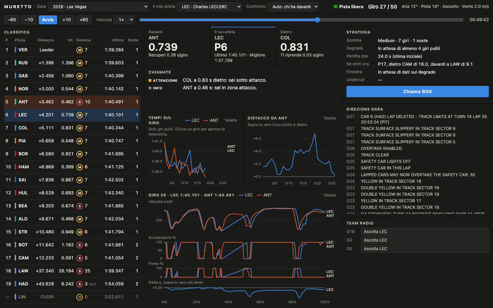

<div align="center">

# 🏎️ Muretto box

**An F1 race-engineer pit wall for your laptop screen.**

Pick your driver and follow gaps, tyres, pit window, rejoin position, telemetry against a rival, team radio and race control, live or as a replay.


</div>



## What you get

- **Live classification** with gaps, intervals, tyre compound and age, last lap, pit stops.
- **Your driver at the centre**: car ahead / behind, gap trend in s/lap ("closing 0.38 s/lap"), automatic calls such as *under attack* or *in attack range*.
- **Strategy panel**: tyre degradation from clean laps, pit-loss estimate, **where you would rejoin if you boxed now**, pit window and undercut threat.
- **Box call game**: press *Chiama BOX* to log your decision and compare it with what the team actually did.
- **Telemetry overlay**: speed, throttle, brake and delta along the lap against a rival; click any lap in the lap-time chart to open it.
- **Race control and team radio** feeds, weather and track status.
- **Replay controls**: play/pause, ±10 s / ±60 s, speed, scrubbing, ideal for syncing with the broadcast.

## Run it

Zero dependencies beyond Node 20+.

```bash
npm start      # http://localhost:8420
npm test       # model and live-timing parser tests (node:test)
```

| Key | Action |
|---|---|
| Space | Play / pause replay |
| ← → | −/+ 10 s |
| Shift + ← → | −/+ 60 s |
| Click a driver | Use as comparison |
| Click a lap | Open its telemetry |

## Data sources

- **Past sessions** from [OpenF1](https://openf1.org) (free), cached locally.
- **Live sessions** from recordings of the official live-timing feed written by its companion project [**f1-telemetry-live**](https://github.com/GiuseppeSavoia/f1-telemetry-live) (Fast-F1). The panel tails the recording every 3 s, follows real time and lets you drop back to "delayed" mode to stay in sync with the video. Start/tyre history is reconstructed when the feed joins mid-race.

On Mexico 2026 the two sources agree on > 99% of lap times, the finishing order and telemetry.

## Structure

```
server.mjs        tiny HTTP server + OpenF1 proxy/cache
livetiming.mjs    parser for Fast-F1 live-timing recordings
public/           UI and race model (vanilla JS, SVG charts)
multiviewer/      helper to build a MultiViewer window layout
tools/            replay a past recording as if it were live
test/             node:test suites
```

- 🇮🇹 [Full guide (Italian)](docs/GUIDA.md)

---

<sub>Built by <a href="https://github.com/GiuseppeSavoia">Giuseppe Savoia</a>. Unofficial fan project, not associated with Formula 1 companies. F1 is a trademark of Formula One Licensing B.V.</sub>
